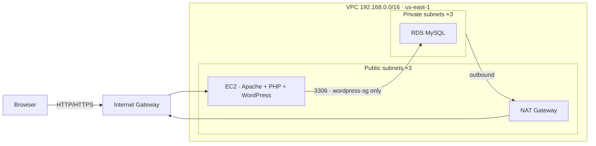

# WordPress on AWS with Terraform

**312 School · DevOps Bootcamp** · June 2025

I wrote Terraform to deploy WordPress on AWS with a two-tier network. The web server runs on EC2 in a public subnet. The MySQL database runs on Amazon RDS in private subnets and accepts connections only from the web server's security group.

## Architecture



## What it builds

| Layer | Resources |
|---|---|
| Network | VPC, Internet Gateway, NAT Gateway with Elastic IP, 3 public and 3 private subnets across availability zones, public and private route tables |
| Security | `wordpress-sg` allows HTTP/HTTPS from the internet and SSH only from `ssh_allowed_cidr`. `rds-sg` allows MySQL 3306 only from `wordpress-sg` |
| Compute | EC2 instance (Amazon Linux 2) that installs Apache, PHP, and WordPress through `user_data` |
| Database | RDS MySQL in a DB subnet group of private subnets, not publicly accessible |

## Repository layout

```
.
├── main.tf                    # Root module: wires all modules together
├── variables.tf               # Inputs (region, key pair, SSH CIDR, DB credentials)
├── outputs.tf                 # EC2 IP, WordPress URL, RDS endpoint
├── locals.tf                  # Subnet CIDRs and AZs, web ports
├── terraform.tfvars.example   # Example inputs (copy to terraform.tfvars)
├── scripts/user_data.sh       # Installs Apache, PHP, and WordPress
├── vpc/ ig/ nat/ rt/ subnet/  # Network modules
├── sg/                        # Security group module
├── ec2/                       # EC2 module
└── rds/                       # RDS MySQL module
```

## How to run

Prerequisites: Terraform 1.5 or newer, AWS credentials for your own account, and an existing EC2 key pair.

```bash
cp terraform.tfvars.example terraform.tfvars   # set key_name and ssh_allowed_cidr
export TF_VAR_db_password='choose-a-strong-password'

terraform init
terraform plan
terraform apply
```

Open the `wordpress_url` output to see the WordPress setup page. When you finish, run `terraform destroy`. The NAT Gateway and RDS instance cost money while they run.

## Design choices

- **Secrets stay out of Git.** The database password comes from `TF_VAR_db_password` or a git-ignored `terraform.tfvars` file. Terraform marks it as sensitive.
- **The database is private.** RDS runs only in private subnets. Its security group references `wordpress-sg` instead of allowing an IP range.
- **SSH is restricted.** HTTP and HTTPS are open to the internet. SSH accepts only the CIDR you pass in.
- **Modules are reusable.** Each network and compute piece is a small module, and subnets are created with `for_each` from a map in `locals.tf`.

## What I would add next

- Move WordPress behind an Application Load Balancer with an ACM certificate for HTTPS
- Run the web tier in an Auto Scaling group across availability zones
- Store Terraform state in S3 with locking
- Use AWS Secrets Manager for the database password
